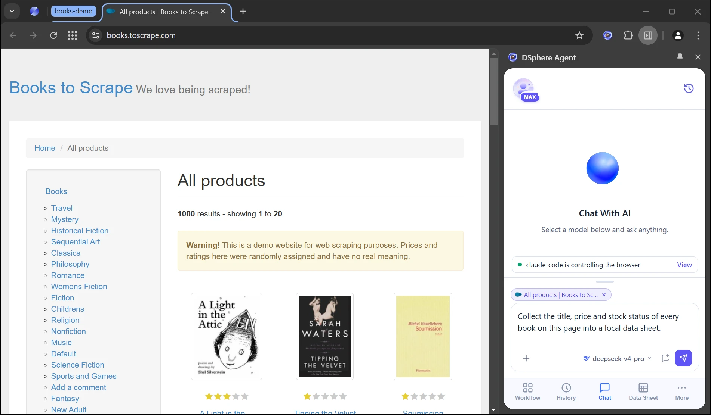
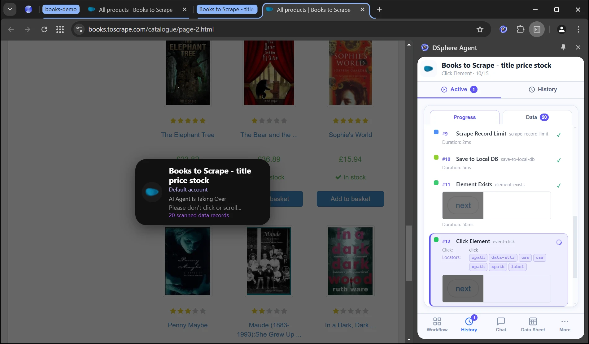
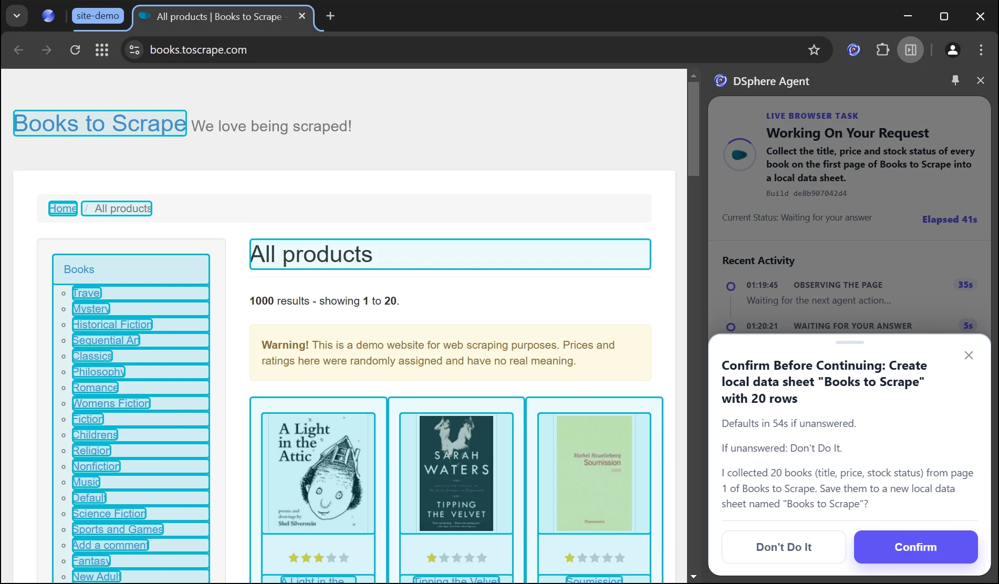
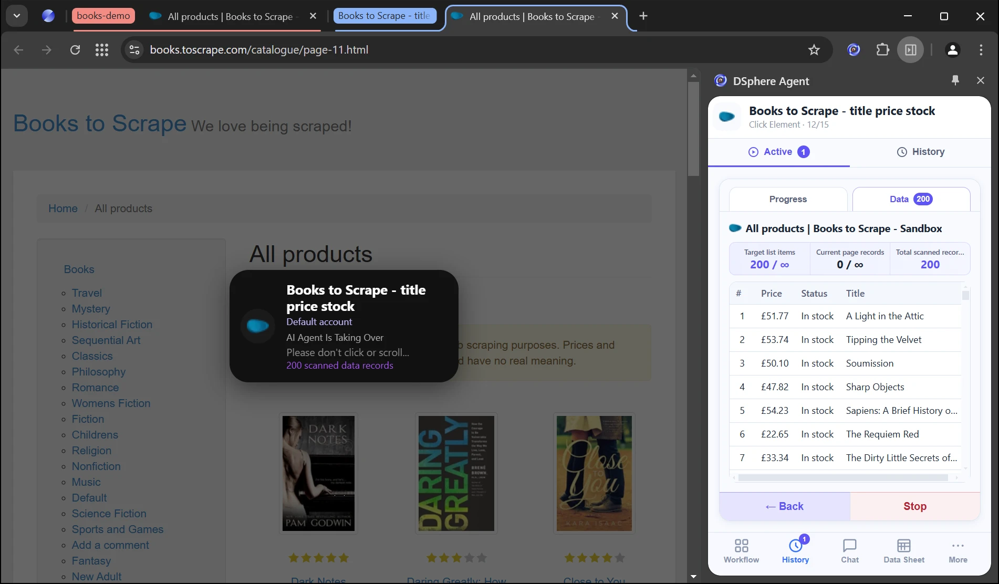
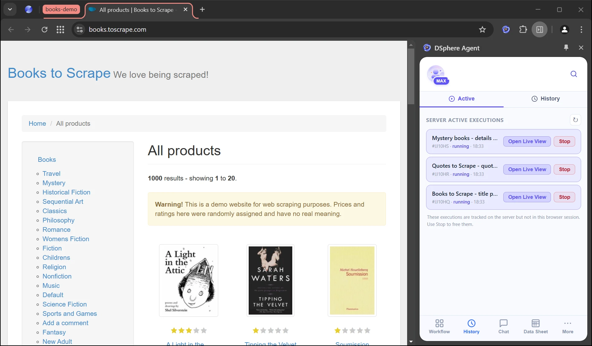
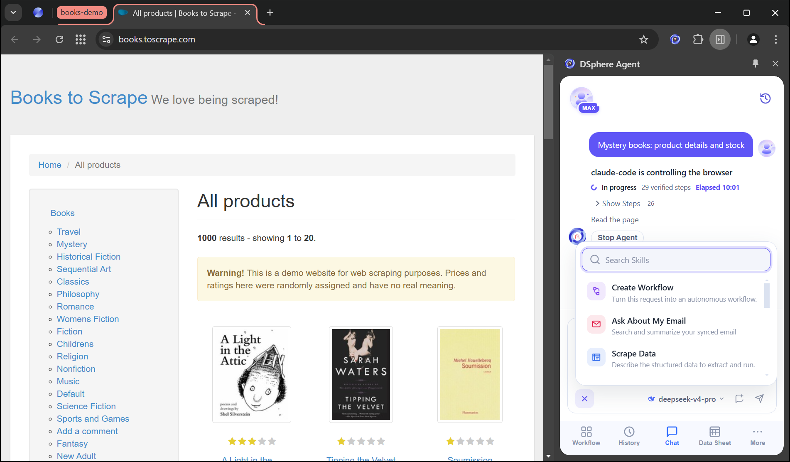
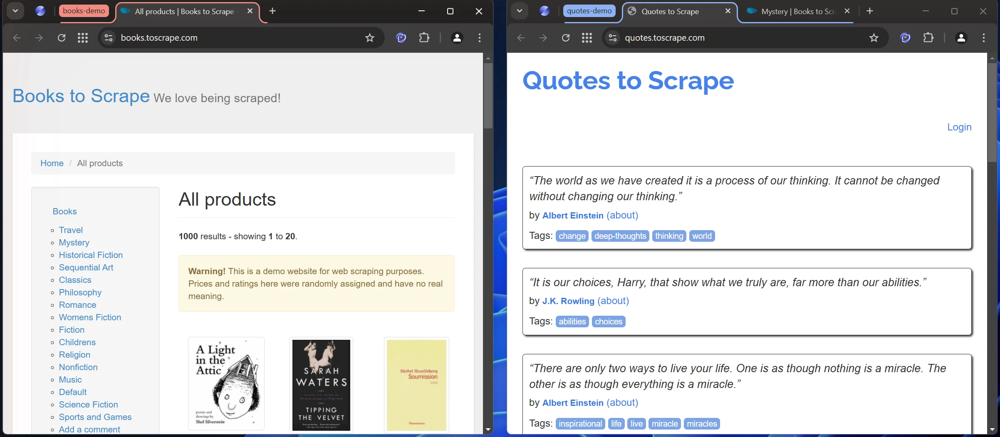

<p align="center">
  <a href="https://www.dsphereai.com/"></a>
</p>

<h1 align="center">DSphere Agent</h1>

<p align="center">
  <b>Give your AI agent a real browser.</b><br>
  Claude Code, Codex, Cursor, WorkBuddy and other AI agents plan the task; the DSphere browser carries it out
  in the sessions you are already signed in to, with you watching and in control.
</p>

<p align="center">
  <a href="https://www.dsphereai.com/">Website</a> ·
  <a href="https://work.dsphereai.com/download/index.html">Download the DSphere browser</a> ·
  <a href="installation-guide.md">Installation and update guide</a> ·
  <a href="RELEASE.md">Release validation</a> ·
  <a href="README.zh-CN.md">中文</a>
</p>

<p align="center">
  
</p>

Current release: **1.10.0**.

Download the [immutable 1.10.0 package](https://github.com/dsphere/dsphere-agent/archive/refs/tags/dsphere-agent-v1.10.0.zip), extract it, and install the complete `skills/dsphere-agent/` directory after verification. Follow the [installation guide](installation-guide.md) for your platform and client.

## What is DSphere Agent?

DSphere Agent is the official Skill and local MCP connector that lets an AI agent work in the **DSphere browser**, an agentic browser with a signed-in, multi-account workspace, web data extraction and AI processing.

- **Your agent plans.** It reads each page, decides the next step and calls the browser through three stable MCP tools.
- **The browser acts.** Each step runs in the DSphere browser on your computer, in the sessions and app accounts you already signed in to. No passwords are handed to the agent.
- **You stay in control.** You can watch every step live, confirm sensitive actions, take over sign-ins and CAPTCHAs, and stop the agent at any time.

The Skill installs and configures **Native Agent**, a local stdio MCP server named `dsphere-agent`, and bundles it for Windows x64/x86 and macOS Intel/Apple Silicon.

## Quick start

1. **Install the DSphere browser** from the [official download page](https://work.dsphereai.com/download/index.html) and keep it running.
2. **Copy this prompt to your AI assistant** (Claude Code, Codex, Cursor, WorkBuddy and more). It installs or updates the Skill and the MCP connector for you, and asks you to confirm the version and changes before writing anything:

   ```text
   Help me install or update the dsphere-agent Skill: https://github.com/dsphere/dsphere-agent/blob/main/installation-guide.md
   ```

3. **Restart your assistant if it asks**, then ask it to list the online DSphere browsers to check the connection.
4. **Give it a browser task**, for example: *"Collect the title, price and stock status of every book on books.toscrape.com into a local data sheet."*

Prefer not to use an outside agent? The DSphere browser has a built-in **Chat** that runs the same tasks with no Skill or MCP setup.

## How it works

```text
 Your AI agent                  Native Agent (local MCP)          DSphere browser
 ─────────────────              ───────────────────────          ─────────────────────────────
 Claude Code, Codex,     ──▶    dsagent_list_instances    ──▶    Pages, signed-in sessions,
 Cursor, WorkBuddy, ...         dsagent_list_capabilities        app accounts, data sheets
 plans every step               dsagent_invoke                   runs every step, you watch
```

1. **Your AI agent** plans the task and decides each step.
2. **Native Agent** is a local stdio MCP server, installed and configured through the Skill. It passes each step to the browser and brings back the result.
3. **The DSphere browser** runs each step in the sessions you signed in to, and publishes the live list of what an agent may call.

Your agent discovers every method live from the browser and calls only what it offers.

## What your agent can do

| Capability | What it means | Example methods |
|---|---|---|
| **Read and act on pages** | Observe a page, find targets, then click, type and scroll in checked steps. | `page.observe` · `page.find` · `page.action` · `page.markdown` |
| **Reuse signed-in sessions** | Open pages in the DSphere session or app account you already signed in to. No new logins. | `browser.sessions.list` · `page.account.detect` · `app.accounts.list` |
| **Collect data** | Run the scrape wizard; it detects lists, tables and pagination and saves rows to a local data sheet or a CSV file. | `wizard.start` · `execution.data.export` |
| **Run saved tasks** | Start a saved workflow, wait for it or stop it, then read its results. | `execution.run` · `execution.wait` · `execution.stop` |
| **Files and email** | Find and download files on a page. Search, read and send mail from your own account. | `page.files.download` · `mail.search` · `mail.send` |
| **Ask you when it matters** | Ask a question or a confirmation in the live task panel, or call you to the page. | `page.ask` · `page.notify` |
| **Watch every browser task** | See the tabs and tasks of every source (agents, Chat, you) and help when one is stuck. | `monitor.snapshot` · `monitor.assist` |

## Product tour

### Watch your agent work, step by step

The live task panel shows every step with its result, the records collected so far, and who is controlling the browser.



### You confirm what matters

Sensitive actions wait for your **Confirm**. Nothing is sent, saved or submitted on your behalf without it.



### Collect web data into local data sheets

The scrape wizard turns repeated records (lists, tables, search results, comments) into rows and follows the page's pagination to the end. Results stay on your computer and download as Excel or CSV.



### Run tasks in parallel

Several tasks run at once, each in its own tab group, and each can be opened live or stopped on its own.



### Built-in Chat and skills

Prefer to type the task yourself? Chat runs it in the same browser, with ready-made skills for scraping, forms, images, email and turning a request into a reusable workflow.



### Separate sessions and accounts

Keep stores, creator accounts and clients apart: each session or app account has its own tabs, cookies, proxy and browser profile.



[Watch the product video](https://static-dsphere-com-cn.oss-cn-hangzhou.aliyuncs.com/official-website/agent_brand.mp4)

## Safety and control

- **Runs locally.** Your agent reaches the DSphere browser through a local stdio server on your computer.
- **No passwords needed.** It reuses the sessions you signed in to within DSphere. Sign-ins and CAPTCHAs are handed to you.
- **You confirm what matters.** Sensitive actions wait for your Confirm in the live task panel.
- **Stop anytime.** Chat shows which agent is controlling the browser, with a **Stop Agent** button.
- **Bounded by design.** Agents get redacted, size-limited page evidence and call only the methods the browser publishes. They can't run arbitrary scripts or SQL, open arbitrary URLs or file paths, or pass credentials through.

## Supported clients and platforms

| | |
|---|---|
| **AI clients** | Claude Code, Codex, Cursor, WorkBuddy, TRAE Work, Qianwen Office, and any agent that can start a local stdio MCP server |
| **Operating systems** | Windows x64 and x86, macOS Intel and Apple Silicon |
| **Browser** | The DSphere browser ([download](https://work.dsphereai.com/download/index.html)) |
| **MCP tools** | `dsagent_list_instances`, `dsagent_list_capabilities`, `dsagent_invoke` (plus `dsagent_read`, `dsagent_launch_browser`, `dsagent_get_runtime_status` and `dsagent_upload_file` as helpers) |

If your client cannot install Skills, install the official connector with the [full installation guide](installation-guide.md) first, then add its local stdio server in your client's MCP settings. The package includes client setup instructions.

## Repository layout and installation rules

| Path | Contents |
|---|---|
| `skills/dsphere-agent/` | The complete Skill of the latest release: `SKILL.md`, capability references, installation scripts, integrity manifests and the Native Agent binaries for Windows x64/x86 and macOS Intel/Apple Silicon. |
| `installation-guide.md` | Bilingual installation and update guide for every supported platform and client. |
| `latest-version.json` | The version pointer: only the latest stable version and its tag. |
| `RELEASE.md` | Provenance, Native checksums and validation of the current release. |
| `docs/images/` | Images used by this README. |

This distribution uses `https://github.com/dsphere/dsphere-agent.git` and the version pointer at `https://raw.githubusercontent.com/dsphere/dsphere-agent/main/latest-version.json`. Updates stay in this repository. Always install the exact immutable tag named by the validated pointer.

The Git tag `dsphere-agent-v<version>` is the only source of truth for a version. Read `version` and `tag` from `latest-version.json`, require the tag to match the version exactly, and take `skills/dsphere-agent/` only from that tag. Confirm with the user before writing to the client's Skill directory.

The Skill is authored in the DSphere integration repository (`native-agent/skills/dsphere-agent/`) and published here; please don't edit this mirror directly.

## FAQ

**Do I need to give my agent my passwords?**
No. Your agent reuses the sessions you signed in to within the DSphere browser. When a sign-in or CAPTCHA needs you, it asks you to step in.

**How do I stop an agent?**
Chat shows which agent is controlling the browser. Click **Stop Agent**, or stop the run in the live task panel.

**My agent cannot find the browser. What now?**
Keep the DSphere browser open and copy the setup prompt again. Ask your assistant to follow the guide to check the version, the Native Host registration and the MCP configuration, then reconnect and verify. If setup or an update fails, keep the last verified Skill.

**How do I update?**
Send the same setup prompt again. The assistant compares your installed version with `latest-version.json`, shows you the change and installs the new immutable tag only after you confirm.

## Links

- Website: <https://www.dsphereai.com/>
- Download the DSphere browser: <https://work.dsphereai.com/download/index.html>
- Mirror for users in mainland China: <https://gitee.com/dsphere/dsphere-agent-skills>
- License: [MIT](LICENSE)
